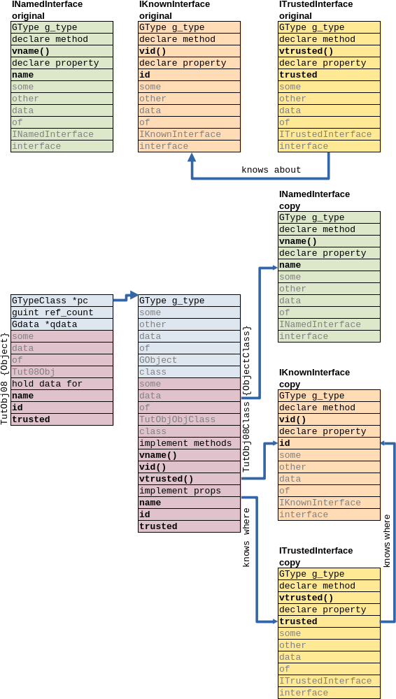

## Interfaces, interface inheritance, implementing interfaces in object

Source code for this chapter is in [/src/gobj-08/](../src/gobj-08/) directory.

In this tutorial we will create several interfaces and an object implementing
that interfaces. One of our interfaces will extend anoter. We will see what it
mean for object implementing it.

Interfaces are widely used in GTK UI implementation too. Known abstract sets of
methods and properties associated with different implemetations is usual way to
do polymorphic objects.

Also, we implement contruction-only and storageless properties in our object.

### Class relations

We will declare three interfaces:
- INamed, implementing virtual method `vname` and string property "name"
- IKnown, implementing virtual method `vid` and int property "id"
- ITrusted, implementing virtual method `vtrusted` and boolean property
"trusted"

The last, ITrusted, interface also extends IKnown interface.

Interfaces are similar to ordinary classes. They have type identifier, may be
derived from, they have class structure, which may contain virtual table, they
can store some data and so on. The diffrenece is that interfaces are not
intended for creation of instances on its own. Interfaces are like abstract
classes that are used just to define (and describe) particular aspects of
behavior. And instances of "real" classes have (implement) those aspects.

Note that interface itself may implement its functionality, for example, may
have real implementation of its virtual method. But, usually, it is not
interfaces used for.

Any class may implement many interfaces at once. Simple single-ancestor model
won't fit such class relations, so classes maintain a separate *lists of
interfaces* they want to implement. Interfaces do not have ancestors, but
declare so called prerequisites. Prerequisites of an interface is a declaration
of at most one instantiable class and zero or more interfaces to which the
object implementing this specific interface must conform.

GObject library
[have API](https://docs.gtk.org/gobject/type_func.TypeInterface.add_prerequisite.html)
to *add* so called "prerequisite" to interface. This API may be used many times,
but documentation states that *instantiable* prerequisite (normal class) is at
most one, like single ancestor.

Any "real" class implementing some interface must implement prerequisite (or
"ancestor") of that interface (if any) too. "Default ancestor" for interfaces
without prerequisites is GObject, and any class always have GObject implemented.

<a name="class-iface-memory-model"></a>
Suppose the following memory model:



There is always at least one way for GObject library to find interface
descriptions that are associated with some class. These interface descriptions
are made as a *copies* of "original" interface descriptions, created at
interface registration stage. In that *copies* class may, for example, place
pointers to functions implementing interface's virtual methods. Library manages
memory allocation, deletion, copying and initialization of interface
descriptions automatically, same as it does it for classes.

Interface declarations should be similar to non-final class declarations. Its
class structure definitions should be known for descendants and implementors.
There are no "final interfaces".

And what about classes that are derived from classes that implemented an
interface? As usual, such derived classes have access to structure of its
ancestors. So, derived class may find, for example, virtual table of interface
that implemented by ancestor. To hide complexities of such navigation in class
hierarchy we may implement convenient wrappers in public interface of derived
class.

Similarly, interface having prerequisite of other interface have access to
structure of the later. Derived interface may use or (try to) change
functionality of its prerequisite interface. Here "try to" is to state that
functionality of interface is often implemented in "real" class, and thus have
good chances to be *overriden* by that "real" class.

### INamed interface declaration

Full source code is in [src/gobj-08/tut-inamed.h](../src/gobj-08/tut-inamed.h).

There are [standard four parts](gobj-04.md#base-object-declaration), almost same
as we already seen in derivable class:

```C
#define TUT_TYPE_INAMED (tut_inamed_get_type ())

G_DECLARE_INTERFACE (TutINamed, tut_inamed, TUT, INAMED, GObject)

/* Make vtable structure visible for implementors */
struct _TutINamedInterface {
    GTypeInterface parent_iface;
    const gchar* (*vname) (TutINamed *self); /* Used as:
                                                    iface->vname (instance) */
    void * __vtable_resv[1];                 /* 1 more slot to add virtual
                                                methods without breaking ABI */
};

/* Public interface to our object */
const gchar *tut_inamed_vname (TutINamed *self);
const gchar *tut_inamed_get_name (TutINamed *self);
void         tut_inamed_set_name (TutINamed *self, const gchar *name);
```

Difference is in macro `G_DECLARE_INTERFACE` that we use to declare interface,
but not class. By convention, this macro uses C symbols like
`_TutINamedInterface` in place of `_TutINamedClass` as it was with macro
`G_DECLARE_DERIVABLE_TYPE`.

Virtual table is also placed in interface structure, and also
[may have reserved space](gobj-04.md#base-object-declaration).

### INamed definition and initialization 

Full source code is in [src/gobj-08/tut-inamed.c](../src/gobj-08/tut-inamed.c).

The definition and initialization of interface is much simplier than it was with
classes:

```C
static void tut_inamed_default_init (TutINamedInterface *iface);

G_DEFINE_INTERFACE (TutINamed, tut_inamed, G_TYPE_OBJECT)

/* custom part of construction/destruction */

static void
tut_inamed_default_init (TutINamedInterface *iface)
{
    g_print ("entered tut_inamed_default_init ()\n");
    g_object_interface_install_property (iface,
        g_param_spec_string ("name",
                             "Name",
                             "Arbitrary name.",
                             NULL,
                             G_PARAM_READWRITE | G_PARAM_STATIC_STRINGS));
    iface->vname = NULL; /* pure virtual */
}
```

There is only one conventionally-named function `tut_inamed_default_init ()` and
typical convenience macro `G_DEFINE_INTERFACE`. In initialization function we do
two things:
- *declare existence* of property `name` with string type
- set to NULL pointer to implementation of virtual method `vname ()`

Although it is possible, we are not going to give some "default" implementation
for `vname` method in this interface implemetation file. We leave the job of
implementation to class that implement this interface.

The same with property: we just tell the library that such property exist. We do
not assign ordinal number, do not implement property getter and setter
dispatchers and do not allocate storage for that property.

### INamed public interface 

Public interface consist of three conenience wrappers: for `vname` method,
getter for property "name" and setter for it. `vname` wrapper is typical:

```C
const gchar*
tut_inamed_vname (TutINamed *self)
{
    TutINamedInterface *iface;
    const gchar *res;

    g_print ("entered tut_inamed_vname () [[\n");
    g_return_val_if_fail (TUT_IS_INAMED (self), NULL);
    iface = TUT_INAMED_GET_IFACE (self);
    g_return_val_if_fail (iface->vname != NULL, NULL);
    res = iface->vname (self);
    g_print ("]] tut_inamed_vname ()\n");
    return res;
}
```

It checks passed `self` to be our interface indeed, and checks we have an
implementation of `vname` in our (*copy* of) virtual table. If both checks
succeed, `vname` called by pointer from virtual table.

Property getter for property "name" uses `vname` implementation (it's just to
use that possibility) to fetch value:

```C
const gchar*
tut_inamed_get_name (TutINamed *self)
{
    TutINamedInterface *iface;
    const gchar *res;

    g_print ("entered tut_inamed_get_name () [[\n");
    g_return_val_if_fail (TUT_IS_INAMED (self), NULL);
    iface = TUT_INAMED_GET_IFACE (self);
    g_return_val_if_fail (iface->vname != NULL, NULL);
    res = iface->vname (self);
    g_print ("]] tut_inamed_get_name ()\n");
    return res;
}
```

Property setter for property "name" wraps generic property access method from
GObject:

```C
void
tut_inamed_set_name (TutINamed *self, const gchar *name)
{
    GValue gval = G_VALUE_INIT;

    g_print ("entered tut_inamed_set_name () [[\n");
    g_return_if_fail (TUT_IS_INAMED (self));
    g_value_init (&gval, G_TYPE_STRING);
    g_value_set_string (&gval, name);
    g_object_set_property (G_OBJECT (self), "name", &gval);
    g_value_unset (&gval);
    g_print ("]] tut_inamed_set_name ()\n");
}
```

That last method guarantee that property change notification will be emitted
from object.

### IKnown interface

Full source code is in [src/gobj-08/tut-iknown.h](../src/gobj-08/tut-iknown.h)
and [src/gobj-08/tut-iknown.c](../src/gobj-08/tut-iknown.c).

Interface IKnown declared and implemented almost same as INamed before. The
difference is in names and types of virtual method and property. IKnown has
virtual metod `vid` and property "id" of type int.

Property "id" is declared as construct-only:

```C
        g_param_spec_int ("id",
                          "Id",
                          "This entity id.",
                          G_MININT,
                          G_MAXINT,
                          0,
                          G_PARAM_CONSTRUCT_ONLY | G_PARAM_READWRITE |
                              G_PARAM_STATIC_STRINGS));
```

It means that value of this property may only be set at construction of
instance, using additional parameters in generic GObject constructor
`g_object_new ()`. If object is constructed with default contructor, property 
"id" will have default value forever. So, public interface to IKnown even have
no setter function for "id".

### ITrusted interface

Full source code is in
[src/gobj-08/tut-itrusted.h](../src/gobj-08/tut-itrusted.h).and 
[src/gobj-08/tut-itrusted.c](../src/gobj-08/tut-itrusted.c).

Interface ITrusted, again, declared and implemented almost same as INamed
before. Its virtual method named `vtrusted`, and property named "trusted".
Property declared as read-only as it designed to be storageless, calculated
in property getter:

```C
        g_param_spec_boolean ("trusted",
                              "Trusted",
                              "Indicates this entity' id is trusted.",
                              FALSE,
                              G_PARAM_READABLE | G_PARAM_STATIC_STRINGS));
```

Public interface to ITrusted have no setter function for "trusted" too.

### Object declaration

Full source code is in [src/gobj-08/tut-obj08.h](../src/gobj-08/tut-obj08.h).

File consists of
["standard" parts for final class](gobj-05.md#object-declaration) TutObj08.
Public interface is limited to construction functions only:

```C
TutObj08 *tut_obj08_new (void);
TutObj08 *tut_obj08_new_full (const gchar* name, gint id);
```

Second function `tut_obj08_new_full ()` construct object with already set
properties, includig construction-only property "id" from interface IKnown.

### Object implementation -- type definition and internal declarations

Full source code is in [src/gobj-08/tut-obj08.c](../src/gobj-08/tut-obj08.c).

There is much more internal definitions in our TutObj08 than we seen before.

```C
typedef enum {
    PROP_NAME = 1,
    PROP_ID,
    PROP_TRUSTED,
    N_PROPERTIES
} TutObj08PropEnum;

struct _TutObj08 {
    GObject parent_instance;
};

typedef struct _TutObj08Private TutObj08Private;
struct _TutObj08Private {
    gchar *name;
    gint id;
};

static void         tut_obj08_class_init (TutObj08Class * klass);
static void         tut_obj08_init (TutObj08 * self);
static void         tut_obj08_finalize (GObject * gobject);
static void         tut_obj08_inamed_init (TutINamedInterface * iface);
static void         tut_obj08_iknown_init (TutIKnownInterface * iface);
static void         tut_obj08_itrusted_init (TutITrustedInterface * iface);
static const gchar *tut_obj08_inamed_vname_impl (TutObj08 * self);
static gint         tut_obj08_iknown_vid_impl (TutObj08 * self);
static gboolean     tut_obj08_itrusted_vtrusted_impl (TutObj08 * self);
static void         tut_obj08_get_property (GObject * object,
                                            guint property_id,
                                            GValue * value,
                                            GParamSpec * pspec);
static void         tut_obj08_set_property (GObject * object,
                                            guint property_id,
                                            const GValue * value,
                                            GParamSpec * pspec);

/* interface definition magic is in that '_WITH_CODE' additions */
G_DEFINE_FINAL_TYPE_WITH_CODE (TutObj08, tut_obj08, G_TYPE_OBJECT,
                               G_ADD_PRIVATE (TutObj08)
                               G_IMPLEMENT_INTERFACE (TUT_TYPE_INAMED,
                                                      tut_obj08_inamed_init)
                               G_IMPLEMENT_INTERFACE (TUT_TYPE_IKNOWN,
                                                      tut_obj08_iknown_init)
                               G_IMPLEMENT_INTERFACE (TUT_TYPE_ITRUSTED,
                                                      tut_obj08_itrusted_init))
```

As usual for object with storage we define and declare:
- structure of instance
- structure of private storage
- initialization functions for instance and class
- deletion function
- boilerplate code for object with convenience macro

Beyond that, we declare:
- enumeration for property ordinal numbers
- initialization functions for each of the interfaces we implement
- functions for virtual methods of interfaces we implement
- property dispatchers to implement interfaces' properties

We use "extended" form of object definition macro
`G_DEFINE_FINAL_TYPE_WITH_CODE`, where various code snippets may be appended to
a list of simple macro parameters. All that `G_ADD_PRIVATE ()` and
`G_IMPLEMENT_INTERFACE ()` expands to code blocks. These code blocks perform
private data structure registration and interface registration in our class.

### Object implementation -- cached data items

We cache property descriptions for properties we will implement

```C
static GParamSpec *tut_obj08_prop_pspec[N_PROPERTIES] = { NULL, };
```

And, to be consistent with convenience macros, which automatically cache
pointer to our copy of parent class, we cache pointers to our copies of
interface classes:

```C
static TutINamedInterface *tut_obj08_TutINamedInterface = NULL;
static TutIKnownInterface *tut_obj08_TutIKnownInterface = NULL;
static TutITrustedInterface *tut_obj08_TutITrustedInterface = NULL;
```

### Object implementation -- initializations

In class initialization function we should set up our setter and getter for
properties and tell GObject library that we *override* implementations of
that properties. When we override properties, generic property accessors in
GObject will know that they must look for all that overriden properties in our
class.

```C
static void
tut_obj08_class_init (TutObj08Class *klass) {
    GObjectClass *object_class = G_OBJECT_CLASS (klass);

    g_print ("entered tut_obj08_class_init ()\n");
    object_class->finalize = tut_obj08_finalize;
    object_class->set_property = tut_obj08_set_property;
    object_class->get_property = tut_obj08_get_property;

    /* actually implement all properties */
    g_object_class_override_property (object_class, PROP_NAME, "name");
    g_object_class_override_property (object_class, PROP_ID, "id");
    g_object_class_override_property (object_class, PROP_TRUSTED, "trusted");
}
```

In each of the interface initialization functions we:
- cache pointer to our copy of interface's class structure
- set up pointer to our implementing function in virtual table of this copy
- and get from that interface a description of a property it declared (to cache
this description for future use)

```C
static void
tut_obj08_inamed_init (TutINamedInterface *iface)
{
    g_print ("entered tut_obj08_inamed_init ()\n");
    tut_obj08_TutINamedInterface = iface;
    iface->vname =
        (const gchar* (*) (TutINamed *)) tut_obj08_inamed_vname_impl;
    tut_obj08_prop_pspec[PROP_NAME] =
        g_object_interface_find_property ((GTypeInterface *) iface, "name");
}
```

In instance initialization function, as usual, we give default values for data
items in our private storage.

```C
static void
tut_obj08_init (TutObj08 *self) {
    TutObj08Private *priv;

    g_print ("entered tut_obj08_init ()\n");
    priv = tut_obj08_get_instance_private (self);
    priv->name = NULL;
    priv->id = 0;
}
```

In finalization function we free allocated memory allocated for private data:

```C
static void
tut_obj08_finalize (GObject *gobject)
{
    TutObj08Private *priv;

    g_print ("entered tut_obj08_finalize ()\n");
    priv = tut_obj08_get_instance_private (TUT_OBJ08 (gobject));
    if (priv->name) /* delete on finalize */
    {
        g_print ("\tfreeing\n");
        g_free (priv->name);
        priv->name = NULL;
    }
    G_OBJECT_CLASS (tut_obj08_parent_class)->finalize (gobject);
}
```

### Object implementation -- virtual methods and properties

We define three functions implementing virtual methods of all our interfaces.
Addresses of these functions we put into virtual tables of that interfaces
during interface initialization. Functions are typcal to any virtual method
implementation:

```C
static const gchar *
tut_obj08_inamed_vname_impl (TutObj08 *self)
{
    TutObj08Private *priv;

    g_print ("entered tut_obj08_inamed_vname_impl ()\n");
    g_return_val_if_fail (TUT_IS_OBJ08 (self), NULL);
    priv = tut_obj08_get_instance_private (self);
    return (const gchar*) priv->name;
}
```

(Since we decided to implement property "trusted" as storageless, calculated by
formula "trusted are those whose id is in range 1 .. 9", we don't use storage
for value of "trusted" at all.)

Property access dispatchers made exactly as if properties was declared in our
object. Value of property "trusted" is calculated in property getter.

### Object implementation -- public API

In public API we have simple "default" constructor without parameters, and
another constructor, where we may set initial values for properties "name" and
"id". The later is *the only* way for user code to set value of property "id",
as this property is defined as contruct-only:

```C
TutObj08 *
tut_obj08_new_full (const gchar* name, gint id) {
    TutObj08 *self;

    g_print ("entered tut_obj08_new_full ()\n");
    self = g_object_new (TUT_TYPE_OBJ08, "name", name, "id", id, NULL);
    return self;
}
```

### Creating and using objects

Full source code is in [src/gobj-08/main.c](../src/gobj-08/main.c).

We create two instances of our object, one with default constructor:

```C
    TutObj08 *Alice, *Bob;
    /* ... */
    Alice = tut_obj08_new ();
```

and another with "full" constructor:

```C
    TutObj08 *Alice, *Bob;
    /* ... */
    Bob = tut_obj08_new_full ("Bob", 5);
```

Since we did not implement convenience wrapers in our class implementation, we
use public wrappers, provided in header files of interfaces to access data in
these two objects. We just cast pointers to our objects to pointers to
corresponding interfaces. Anyway, all calls to virtual methods end up in
implementing functions of our object

```C
    g_print ("tut_inamed_vname (Alice): \"%s\"\n",
             tut_inamed_vname (TUT_INAMED (Alice)));
```

and all accesses to properties end up in our object's property access
dispatchers

```C
    GValue gval = G_VALUE_INIT;
    /* ... */
    g_value_init (&gval, G_TYPE_INT);
    g_value_set_int (&gval, 3);
    g_object_set_property (G_OBJECT (Alice), "id", &gval);
    g_value_unset (&gval);
```

We can see that property "id", indeed, can not be changed after creation of
object.
